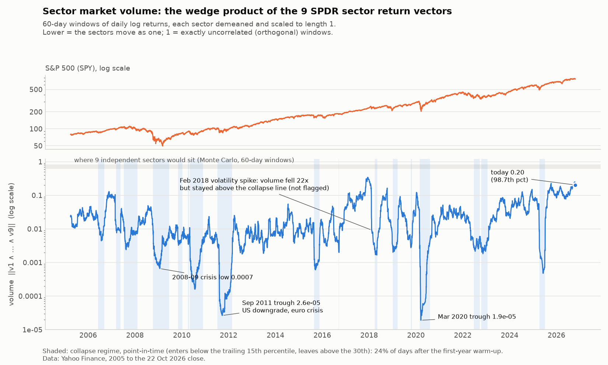

# The Geometry of a Market Crash

*Notes on the video "The Geometry of a Market Crash" (Algebraic Continuation, 29:49) and the essay it is built on,
Agus Sudjianto's "The Geometry of a Crash: Why 'Market Volume' Beats Probabilistic Models" (January 2026).
Written 22 October 2026.*

> **Source note.** These notes were checked against the video's auto-generated English captions (read 22 October 2026)
> and the essay the video is based on (read in full). Each chapter opens with **What the video says**. Everything after
> that is marked as coming from the essay or from these notes (background, or **measured**), because much of it goes
> beyond the video. Every number marked **measured** comes from running the code in Section 4 on Yahoo Finance data up
> to the final 22 October 2026 close (raw figures: `img/sector_wedge_volume_facts.json`). You have watched the video
> twice: if a chapter says something different from what you remember, note it in the margin.

---

## Contents

| | Section | What it gives you |
|---|---|---|
| 0 | [The idea in one paragraph](#0-the-idea-in-one-paragraph) | The whole argument, before the detail |
| 1 | [Chapter by chapter](#1-chapter-by-chapter) | Every topic in the video, with the definitions it needs |
| 2 | [Five identities that tie it together](#2-five-identities-that-tie-it-together) | Proved from things you know, then measured on real data |
| 3 | [How this plugs into the project](#3-how-this-plugs-into-the-project) | Seven concrete places, with file names |
| 4 | [Pseudo code: sector correlation and the Gram volume](#4-pseudo-code-sector-correlation-and-the-gram-volume) | The expanded part you asked for |
| 5 | [Exercises](#5-exercises) | To check you can do it without these notes |

The learning path (where you are now, and how to get here) is in `MATHS_ROADMAP.md`.

---

## 0. The idea in one paragraph

Markets are **non-stationary**: their statistics drift, so they behave as a sequence of **regimes**. The standard way to
detect regimes, the **hidden Markov model**, looks at returns probabilistically and tends to "flicker" between states
whenever one day is unusual. The video's alternative treats each sector of the market as a **vector**: its last 60 daily
returns are one arrow in 60-dimensional space. When sectors move independently, those arrows point in different
directions and the shape they span has a large **volume**. In a crash everything is sold together, the arrows collapse
towards one line, and the volume of the *unit* arrows (each scaled to length 1) falls towards zero. The
**wedge product** $u_1 \wedge \cdots \wedge u_n$ is that oriented volume, and its size is computed from the
**Gram determinant**, $\|u_1 \wedge \cdots \wedge u_n\| = \sqrt{\det G}$. Once every arrow has length 1, that size
depends only on the *angles* between sectors, so it measures the market's **structure** rather than its volatility.
(For the raw arrows the size is $\prod_i |v_i|$ times the unit-arrow volume. It grows with every sector's volatility, so
in a crash the volatility spike can offset or outweigh the collapse in angles. That is why Section 1.6 normalises first.)

---

## 1. Chapter by chapter

### 1.1 Nonstationarity (0:26)

**What the video says.** A distribution is non-stationary when its moments change over time: the mean and the
variance, and also the higher moments (skew, kurtosis). This happens in two ways. The distribution can drift
continuously, which is hard to model (he compares it to propagating wave packets). Or it can jump between a few
stationary distributions. Approximating the first by the second is "the promise" of regime detection, and it is the
bottom-up argument for HMMs. His toy model has two states, Normal returns and Cauchy returns, with a 5% chance of
switching at each step. The notebook demos show clustered returns and clustered volatility, with the Cauchy stretches
shaded red. (A 5% switch chance means $a_{ii} = 0.95$, so a regime lasts $1/0.05 = 20$ steps on average: Section 1.3
and Exercise 5.)

*The rest of 1.1 is background from these notes.*

**Stochastic process.** A sequence of random variables indexed by time, $X_1, X_2, \dots$ (daily returns, for example).

**Strict stationarity.** The joint distribution of $(X_{t_1}, \dots, X_{t_k})$ is the same as that of
$(X_{t_1+h}, \dots, X_{t_k+h})$ for every shift $h$. Nothing about the process depends on the calendar.

**Weak (covariance) stationarity.** The three things you can estimate are constant in time:

$$\mathbb{E}[X_t] = \mu, \qquad \operatorname{Var}(X_t) = \sigma^2 < \infty, \qquad \operatorname{Cov}(X_t, X_{t+h}) = \gamma(h).$$

Weak stationarity constrains only the first two moments, so skew and kurtosis may still drift. The video's definition
(all moments) is the strict one.

**Why prices are not stationary.** A random walk $P_t = P_{t-1} + \varepsilon_t$ has $\operatorname{Var}(P_t) = t\sigma^2$,
which grows with time (a *unit root*). Log returns $r_t = \ln(P_t / P_{t-1})$ remove most of that, but not all:
volatility clusters (calm months and wild months), and correlations between assets change.

**Why it matters to you.** Any number estimated from the past (a mean, a volatility, a correlation, a `vol_index`) has a
shelf life. This project met that head-on today: the market-change formula assumed one fixed mapping from a price change
to volatility, and in the original code's 15-minute SAP backtest (22 October 2026) it produced volatilities from 0.13 to
532 when the real value was about 1. The fix uses the realised volatility of the *previous* window, which
is the standard response to non-stationarity: assume the world is roughly stationary over a short window, and re-estimate.

**Tools.** Rolling windows ("local stationarity"), unit-root tests (ADF, KPSS), differencing, and regime models.

### 1.2 Regimes (5:00)

**What the video says.** Regimes appeal for two reasons. First, they make computation easier: instead of modelling
explicit time dependence, you put it into a label for the current regime and learn $K$ fixed conditional distributions
(two in his example). That is a much smaller search space and a simpler optimisation. The price is that the regimes
themselves are ill-defined. Second, they match intuition: you look at a return distribution and call it low or high
volatility. Possible definitions: low/high volatility, bull/bear, bull/bear/sideways, inflation/stagflation/deflation,
rate cycles, macro variables, and **risk-on/risk-off defined by the correlation between assets**. That last one is the
video's target, and it is what the geometric method measures.

*The table and the two families below are these notes' framing.*

**Regime.** A stretch of time in which the data-generating process is approximately stationary. Markets switch between a
small number of them, for example:

| | Calm / bull | Stress / bear |
|---|---|---|
| Volatility | low | high |
| Drift | positive | negative |
| Correlation between assets | low to moderate | close to 1 |

**Regime detection** labels each date with a regime. There are two families:

- **probabilistic**: each regime is a probability distribution, and the model infers which one generated today's data (HMMs);
- **structural / geometric**: measure a property of the market's shape directly (the wedge volume).

**Already in this project.** `price_change.detect_regime_from_ohlc` labels `low_vol / high_vol / trending /
mean_reverting` with rules (ATR quantile, efficiency ratio), and the self-correction learns a volatility multiplier per
regime (`regime_vol_multipliers.csv`). A geometric regime label would slot in beside it (Section 3).

### 1.3 Hidden Markov models (7:08)

**What the video says.** In regime detection an HMM's job is *state decoding*: finding the regime at each time. Its
parts are latent states, transition probabilities (5% switching in the toy model), emission probabilities, and an
initial distribution, which he sets aside. His two-state model trained on S&P data shows the problems:

- **you cannot tell the model what the states mean.** The number of states is a hyperparameter. His "downturn" state
  switches on for runs as short as about 4 days and flickers back and forth;
- **the parameters are unstable**;
- **outliers flip the state.** One extreme day can switch the regime, which in automated trading means too many
  entries and exits.

He asks three questions of any regime model. Is it interpretable? Does it hold up out of sample? (Stickiness is easy to
tune in-sample and hard to keep stable out of sample.) How does it handle outliers? His verdict: HMMs are not useless,
but they are overused. If you already know which regime you want, build a direct measure of it.

*Background from these notes (not in the video): the definitions, Rabiner's three problems, and the filtering formula.*

**Markov chain.** A sequence of states $S_t \in \{0, \dots, K-1\}$ with the **Markov property**: tomorrow depends only on
today,

$$P(S_t = j \mid S_{t-1} = i, S_{t-2}, \dots) = P(S_t = j \mid S_{t-1} = i) = a_{ij}.$$

**Transition matrix** $A = (a_{ij})$: each row sums to 1. The diagonal measures "stickiness".

**Expected regime length.** Staying exactly $k$ days has probability $a_{ii}^{\,k-1}(1-a_{ii})$ (a geometric
distribution), so

$$\mathbb{E}[\text{length}] = \sum_{k \ge 1} k\, a_{ii}^{\,k-1}(1 - a_{ii}) = \frac{1}{1 - a_{ii}}.$$

The sum is not a plain geometric series, because of the factor $k$. Differentiate $\sum_{k \ge 0} x^k = 1/(1-x)$ to get
$\sum_{k \ge 1} k x^{k-1} = 1/(1-x)^2$, or read it off the binomial expansion of $(1-x)^{-2}$ (A-level Pure). Multiply
by $1 - a_{ii}$. With $a_{ii} = 0.98$ a regime lasts 50 days on average.

**Hidden.** You never observe $S_t$, only **emissions** $O_t$ (returns). Each is drawn from the current state's
distribution, $O_t \mid S_t = k \sim \mathcal{N}(\mu_k, \sigma_k^2)$, or $\mathcal{N}(\mu_k, \Sigma_k)$ for nine sectors
at once. Returns are continuous, so the probability of any exact value is 0. The recursion below therefore uses the
**density** $b_k(o)$ of that normal distribution, not a probability. The full model is the triple
$(\pi, A, b)$: the initial distribution $\pi_i = P(S_1 = i)$, the transition matrix, and the emission densities.

**The three classic problems** (Rabiner 1989):

| Problem | Question | Algorithm |
|---|---|---|
| Evaluation | How likely is this data under the model? | forward algorithm |
| Decoding | Which state sequence most likely produced it? | Viterbi |
| Learning | Which $A$ and emission parameters fit best? | Baum–Welch (an EM algorithm) |

**Filtering is Bayes' theorem, applied every day.** With $\alpha_{t-1}(i) = P(S_{t-1} = i \mid O_{1..t-1})$:

$$\alpha_t(j) \;\propto\; \underbrace{b_j(O_t)}_{\text{likelihood today}} \;\sum_i \underbrace{\alpha_{t-1}(i)\, a_{ij}}_{\text{prior from yesterday}},$$

then normalise so the $\alpha_t(j)$ sum to 1. That is A-level conditional probability, run as a loop.

**Filtering vs smoothing (where backtests cheat).** *Filtered* probabilities use data up to today. *Smoothed*
probabilities $P(S_t \mid O_{1..T})$ also use the future. `hmmlearn`'s `predict_proba` returns smoothed probabilities, and
the essay fits the HMM on all of 2005–2024 at once. Both see the future, so its HMM baseline is an in-sample comparison.

**Flickering.** A single 3σ day is far more likely under the "crisis" distribution than under the "calm" one, so the
posterior jumps and the label toggles. The usual fixes are a stickier $A$, a minimum regime length, and **hysteresis**
(enter the crisis state above 0.8, leave below 0.2). Keep the video's warning in mind: each of these is easy to tune
in-sample and hard to keep stable out of sample.

### 1.4 Risk through correlation (12:12)

**What the video shows.** An animation of the S&P 500 beside a rolling sector correlation heat-map (blue = high, yellow =
near zero, red = negative). In calm uptrends such as late 2019 the correlations sit near zero, so even a long-only
portfolio is reasonably diversified. In the March 2020 lockdown crash the matrix goes to about 1. That is the saying
"correlations go to one in a crash": an unhedged investor who felt diversified a few months earlier gets a rude
awakening. He says this holds for most crashes that are not explicitly politically driven, and gives 2008 as an
example. He also warns against fully automated, hands-off modelling unless you have very high-capacity models:
understand the assumptions, the data and the domain.

*The formulas below are these notes' addition. They explain why the heat-map turning blue destroys diversification.*

**Covariance and correlation.** $\operatorname{Cov}(X, Y) = \mathbb{E}[(X - \mu_X)(Y - \mu_Y)]$ and
$\rho = \operatorname{Cov}(X,Y) / (\sigma_X \sigma_Y) \in [-1, 1]$. The A-level PMCC $r$ is its sample version.

**Covariance matrix** $\Sigma$ ($n \times n$, symmetric, positive semi-definite) and **correlation matrix** $R$ (the same
thing for standardised variables, with 1s on the diagonal).

**Portfolio variance.** With weights $w$: $\sigma_p^2 = w^\top \Sigma\, w$. For $n$ equal-weighted assets with the same
volatility $\sigma$ and the same pairwise correlation $\rho$ (manual, Part VI.7):

$$\sigma_p = \sigma \sqrt{\frac{1 + (n-1)\rho}{n}}.$$

As $\rho \to 1$, $\sigma_p \to \sigma$: diversification disappears. "In a crisis, all correlations go to one."

**The blind spot of pair numbers.** $R$ holds $n(n-1)/2$ separate pair numbers, but a crash is a *joint* event: the
whole set loses dimensions at once. Section 1.7 shows two cases. In the video's, one pair becoming near-duplicates
barely moves the *average* correlation. In these notes' extra one, every pair looks harmless and yet the set is
linearly dependent (three assets, only two independent directions).

### 1.5 Geometric algebra concepts (15:50): the bridge from FP1

**What the video says.** He credits the idea to Agus Sudjianto's essay and builds it from three ingredients:

1. **the wedge product**: an oriented volume with a magnitude (in 2D, a plane and an area), like the cross product but
   more general;
2. **the Gram matrix**, $G_{ij} = r_i \cdot r_j$, where $r_i$ is sector $i$'s return vector over a rolling window (for
   example 60 days);
3. **determinants**, because $\|r_1 \wedge \cdots \wedge r_n\| = \sqrt{\det G}$ is a volume.

He normalises each sector so that $r_i \cdot r_i = 1$, which bounds the volume between 0 and 1: zero correlation gives
1, perfect correlation gives 0 (Section 1.6 qualifies the "1"). For the 3D picture he factors three sectors' Gram matrix
as $G = LL^\top$ (Cholesky, with $L$ lower-triangular) and draws its vectors as the edges of a parallelepiped
(Section 1.8). For the algebra itself he points to Mathoma's geometric algebra series.

*The rest of 1.5 is these notes' bridge from FP1. The geometric product, $e_{12}$ as $i$, and rotors go beyond the
video.*

You already know three of the four objects.

| Object | Where you met it | Formula | Meaning |
|---|---|---|---|
| Dot product | Core Pure | $a \cdot b = \sum a_i b_i = \lvert a\rvert\lvert b\rvert\cos\theta$ | how parallel |
| Cross product | FP1 | $\lvert a \times b\rvert = \lvert a\rvert\lvert b\rvert\sin\theta$ | area of the parallelogram (3D only) |
| Scalar triple product | FP1 | $a \cdot (b \times c) = \det[a\;b\;c]$ | signed volume of the parallelepiped |
| **Wedge product** | new | $a \wedge b$, $a \wedge b \wedge c$, … | oriented area / volume in **any** dimension |

**The wedge (outer, exterior) product** obeys three rules:

1. **bilinear**: $(\lambda a + b) \wedge c = \lambda\, a \wedge c + b \wedge c$;
2. **antisymmetric**: $a \wedge b = -\, b \wedge a$, and therefore $a \wedge a = 0$;
3. **associative**: $(a \wedge b) \wedge c = a \wedge (b \wedge c)$.

These rules alone do not pin the product down: the product that sends everything to 0 obeys them too. The wedge product
is the most general product that obeys them, with no other relations. In $\mathbb{R}^n$ that comes down to one extra
fact, $e_1 \wedge \cdots \wedge e_n \neq 0$. From it, independent vectors always have a nonzero wedge: extend
$a_1, \dots, a_k$ to a basis $a_1, \dots, a_k, b_{k+1}, \dots, b_n$ and put those $n$ vectors as the columns of $B$; then
$(a_1 \wedge \cdots \wedge a_k) \wedge (b_{k+1} \wedge \cdots \wedge b_n) = \det(B)\, e_1 \wedge \cdots \wedge e_n \neq 0$.
That is the property the whole video rests on (below).

$a \wedge b$ is a **bivector**: an oriented piece of the plane through $a$ and $b$, with area
$\lvert a\rvert\lvert b\rvert\sin\theta$. Swapping the order flips the orientation, like a determinant.

**In coordinates.** In 2D, $a \wedge b = (a_1 b_2 - a_2 b_1)\, e_1 \wedge e_2$. The coefficient is the 2×2 determinant
(Core Pure: the determinant is the area scale factor, and its sign records orientation).

In 3D,

$$a \wedge b = (a_1b_2 - a_2b_1)\, e_{12} + (a_2b_3 - a_3b_2)\, e_{23} + (a_3b_1 - a_1b_3)\, e_{31},$$

which is **the same three numbers as the cross product**. The cross product is the bivector's normal vector. A plane has
exactly one normal direction only in 3D, so the cross product does not carry over to other dimensions in general (a
special one exists in 7D, and nowhere else), while the wedge product works in every dimension.

$$a \wedge b \wedge c = \det[a\;b\;c]\; e_1 \wedge e_2 \wedge e_3 \qquad\text{(your scalar triple product).}$$

**Grade and blades.** Scalars have grade 0, vectors grade 1, bivectors grade 2, trivectors grade 3 … A product of
$k$ vectors $a_1 \wedge \cdots \wedge a_k$ is a **$k$-blade**: an oriented $k$-dimensional volume. In $n$ dimensions you
cannot fit more than $n$ independent directions, so any wedge of $k > n$ vectors is 0.

**The property the whole video rests on:**

$$a_1 \wedge \cdots \wedge a_k = 0 \iff a_1, \dots, a_k \text{ are linearly dependent.}$$

**The geometric product** (the "algebra" in geometric algebra) puts both products into one:

$$ab = a \cdot b + a \wedge b.$$

For unit vectors in the $e_1e_2$-plane, with $\theta$ the *signed* angle from $a$ to $b$,
$ab = \cos\theta + \sin\theta\, e_{12}$, and $e_{12}e_{12} = -1$. So $e_{12}$ behaves exactly
like $i$, and $ab$ is the $e^{i\theta}$ of your complex-numbers work. Mathoma's series (linked in the video description)
develops this into rotors.

**Size of a blade: the Gram determinant.** For any vectors $a_1, \dots, a_k$ in $\mathbb{R}^n$ (with $k \le n$), put
them as the columns of $A$ and let $G = A^\top A$, so $G_{ij} = a_i \cdot a_j$. Then

$$\|a_1 \wedge \cdots \wedge a_k\|^2 = \det G.$$

For $k = 2$ this is **Lagrange's identity**, and you can prove it with A-level trigonometry:

$$\det\begin{pmatrix} a\cdot a & a\cdot b \\ a\cdot b & b\cdot b\end{pmatrix} = |a|^2|b|^2 - (a\cdot b)^2
= |a|^2|b|^2(1 - \cos^2\theta) = |a|^2|b|^2\sin^2\theta = \|a \wedge b\|^2.$$

In $\mathbb{R}^3$ the last term is $|a \times b|^2$. In any other dimension there is no cross product, but $\|a \wedge b\|$
is still the area of the parallelogram on $a$ and $b$.

(**Measured**, on two demeaned sector return vectors in $\mathbb{R}^{60}$ from the window ending 22 October, where no
cross product exists, so this checks the determinant form: both sides equal $5.4143188355\times10^{-5}$.)

### 1.6 Geometric regime detection (21:18)

**What the video says.** He computes the "wedge volume" (he also calls it the "Gram volume"), plots it under the
S&P 500, and shades the regimes found by thresholding it. In crashes it gives a stable, persistent signal with little
flicker (some remains, depending on the threshold). It is far less jumpy than the HMM, so trading on it would cause far
fewer transaction-cost problems. His stated limitation: it sometimes misses a crash. In one zoomed sell-off (not named
in the narration) the volume barely dips, because the sectors kept rotating instead of falling together. That crash
was "geometrically different" from March 2020. Section 1.8 has two measured cases of this limitation: 2008, and
February 2018.

*The five steps below are these notes' version. The nine tickers, the logs and the percentile rule are the essay's or
these notes' choices; the video only says that it thresholds the volume.*

1. **Each sector becomes a vector.** The last $W = 60$ daily log returns of XLK are one point in $\mathbb{R}^{60}$. Nine
   sectors give nine arrows in 60-dimensional space.
2. **Normalise.** Divide each vector by its length, so only its *direction* matters and volatility is removed. If you
   first subtract each sector's mean, then $\cos\theta_{ij}$ is exactly the correlation $\rho_{ij}$. The essay skips the
   demeaning; for daily returns it hardly matters (**measured**: the two log-volume series correlate at 0.9995).
3. **Gram matrix.** $G = U^\top U$ is $9 \times 9$ with $G_{ij} = \cos\theta_{ij}$ (the correlation matrix, if demeaned).
4. **Volume.** $V = \sqrt{\det G}$. Because every vector has length 1, $0 \le V \le 1$ (Hadamard's inequality:
   $\det G \le \prod_i G_{ii} = 1$). The video says zero correlation gives $V = 1$. That holds only for vectors that are
   *exactly* orthogonal (population correlations of zero, after demeaning). In a finite window, sampling noise makes
   even truly independent sectors score less: about 0.73 for $W = 60$ and $n = 9$ (**measured**, Section 4.5). And
   without demeaning, orthogonal is not the same as uncorrelated. So compare against that null, never against 1.
5. **Roll it forward** one day at a time, take logs (it spans more than four orders of magnitude, from
   $1.9\times10^{-5}$ to 0.34), and call the market "collapsed" when $\log V$ falls below a low percentile of its own
   history.

**Why this is structural.** $V$ depends only on angles, so it measures something volatility does not. A market can be
calm but one-dimensional, or volatile without having collapsed. In February 2018 the S&P's 20-day volatility was above
its 85th percentile, and by 9 February the volume had fallen from 0.20 to 0.0092. That is close to its historical
median (0.013), and it stayed above the collapse line (0.0028) through February. A volatility measure ranks markets by
the size of their moves; the volume measures whether the sectors have become one trade.

### 1.7 Geometry vs correlation (23:40)

**What the video says.** Is the volume just average correlation in disguise? On the real S&P sectors, the wedge volume
and the average of the correlation matrix look almost perfectly inversely related (he admits that example was
handpicked). Then a synthetic counterexample: four assets where, after a breakpoint, A and D become almost perfectly
correlated. As the rolling window fills with the new data, the average correlation rises only a little, but the volume
makes a large dip. Lesson: if you watch average correlation as the risk measure for a small portfolio, you can miss two
positions becoming near-duplicates. The volume catches it almost at once.

**Measured** on the nine sectors, 2005–2026: $\log V$ and the average pairwise correlation correlate at $-0.91$. Most of
the time the volume says what the average says; it adds information in the remaining cases.

**The A/D example in numbers** (these notes' calculation, not the video's). Four assets with every $\rho = 0.2$: mean
$\rho = 0.20$, $\det R = 0.82$, $V = 0.91$. Raise only $\rho_{AD}$ to 0.99: the mean rises to just 0.33, but $\det R$
falls to 0.018 and $V$ to 0.13, seven times smaller.

*The rest of 1.7 is these notes' addition.*

**The volume is the determinant of the correlation matrix.** For demeaned unit vectors, $G = R$, so
$V^2 = \det R$. Statisticians call $\det$ of a covariance matrix the **generalised variance**. Three ways to read the
same number, all proved in Section 2 and all **measured equal to 15 decimal places** on the window ending 22 October:

- **Eigenvalues (PCA):** $\det R = \prod_i \lambda_i$. In a crash one eigenvalue (the "market mode") takes most of the
  variance; because $\sum \lambda_i = n$ is fixed, the others must shrink, and so does the product. **Measured:** the
  market mode carried 92% of all sector variance on 19 March 2020 and 93% on 23 September 2011 (about 1.2 effective
  independent bets out of 9), 85% on 23 January 2009, and 30% in the window ending 22 October.
- **Sequential regression:** $\det R = \prod_i \left(1 - R^2_{\,i \mid 1..i-1}\right)$. Each sector contributes the share of
  its variance that the earlier sectors cannot explain. The volume is the product of the *new information* each sector adds.
- **Leave one out:** $V_{\text{all}} / V_{\text{all but } j} = \sqrt{1 - R^2_{\,j \mid \text{rest}}} = 1/\sqrt{\mathrm{VIF}_j}$,
  where $\mathrm{VIF}_j$ is the variance inflation factor from regression diagnostics. The geometry and the textbook
  multicollinearity measure are the same object.

**A second blind spot: joint dependence that no pair shows.** Take three unit vectors in a plane at 120° to each
other. Every pairwise correlation is $-0.5$: moderate, and if anything diversifying. But

$$\det\begin{pmatrix}1 & -0.5 & -0.5\\ -0.5 & 1 & -0.5\\ -0.5 & -0.5 & 1\end{pmatrix} = 0,$$

because $a + b + c = 0$. An equal-weighted portfolio of the three has zero variance. The three vectors span only a
plane, so they are two independent bets, not three (eigenvalues 1.5, 1.5 and 0; effective bets
$n^2/\sum\lambda_i^2 = 9/4.5 = 2$), and one combination of them is a perfect hedge. No pair reveals it; the volume does.

**Today, measured** (the 60 trading days ending with the 22 October 2026 close, 9 SPDR sectors):

| Quantity | Value |
|---|---|
| Pairwise correlations | from −0.56 to +0.56 |
| $\det R$ | 0.0423, so $V = 0.21$ (98.8th percentile since 2005: unusually spread out) |
| Largest eigenvalue | 30.2% of total variance |
| Effective number of independent bets, $n^2/\sum\lambda_i^2$ | 5.3 of 9 |
| Most independent sectors ($1/\sqrt{\mathrm{VIF}}$) | Energy XLE 0.90, Utilities XLU 0.88 |
| Least independent | Staples XLP 0.60, Tech XLK 0.61, Industrials XLI 0.62 |

The chart's last point (0.20, 98.7th percentile) is one day older: it is the window ending 21 October, the value
usable at the open of 22 October. Every point on the chart follows that rule, so it never uses the day it is plotted on.

### 1.8 Market volume visualised (26:52)

**What the video shows.** A 3D animation for three sectors, materials (XLB), financials (XLF) and industrials (XLI),
beside the S&P index and the volume series. The solid is built from the Cholesky factor of the rolling 3×3 Gram matrix,
with its vectors as the edges of a parallelepiped. Its volume is the rolling geometric volume of the three return
series. In crashes it is squashed, most of all in March 2020, when it almost flattens into a 2D shape (determinant and
volume near 0). For three sectors the average correlation would look similar, but it is a different quantity, "which
you may or may not prefer".

**Measured, same three sectors.** Median volume 0.31 since 2005; 0.053 on 19 March 2020 and a low of 0.048 on
7 April 2020, about a sixth of the median, so the box really is nearly flat; 0.75 today. Three independent sectors
would score about 0.98 (90% range 0.93–1.00). Pseudo code to draw it is in Section 4.10.

**Which vectors to draw.** If $G = LL^\top$, the *rows* of $L$ are vectors whose Gram matrix is $G$, because
(row $i$)·(row $j$) $= (LL^\top)_{ij}$. The columns of $L$ give $L^\top L$, a different matrix with the same determinant.
A box drawn from the columns has the right volume, but its edges are not the sectors' vectors (Exercise 8).

**These notes' own measurement: all nine sectors, 2005–2026.**



| Event | Lowest volume | Date |
|---|---|---|
| Covid crash | $1.9\times10^{-5}$ | 19 Mar 2020 |
| US downgrade, euro crisis | $2.6\times10^{-5}$ | 23 Sep 2011 |
| 2010 flash crash and euro stress | $1.6\times10^{-4}$ | 27 Jul 2010 |
| 2025 sell-off (the 60-day window lags the April shock) | $4.8\times10^{-4}$ | 10 Jun 2025 |
| August 2015 devaluation scare | $6.0\times10^{-4}$ | 17 Sep 2015 |
| 2008–09 financial crisis | $6.6\times10^{-4}$ | 23 Jan 2009 |
| Median, 2005–2026 | 0.013 | |
| Last chart point (window ending 21 Oct) | 0.20 | 22 Oct 2026 |
| Nine *independent* sectors (Monte Carlo) | 0.73 (90% range 0.63–0.81) | |

Three things the data says that the essay does not:

1. **2008 is not one of the deepest collapses; 2011 and 2020 are.** In 2008 sectors fell at different speeds (financials
   first), so the structure never folded as completely as in March 2020.
2. **February 2018 checks out, with nuance.** The volume fell 22× in two weeks (0.204 on 26 January, 0.0092 on
   9 February) but stayed above the point-in-time collapse line (0.0028), so it was not flagged. A plain volatility rule
   (S&P 20-day volatility above its 85th percentile) was flagged. The geometry flagged the market later, on 27 March 2018.
3. **Real sectors are almost never "independent".** Even independent sectors would score about 0.73 with 60-day
   windows. The real median is 0.013, about 56 times smaller, because every sector shares the market factor.

### 1.9 Takeaways (28:30), and what to doubt

**The video's takeaway.** He says explicitly that the lesson is *not* that the wedge volume beats HMMs, *not* that
fancy geometry beats statistics, and *not* that intuitive methods beat complex ones. It is: use what works best for
your data and target. Learn as many concepts as you can, work hands-on with the data, let the data do the talking, and
build research intuition by trying many things. (Earlier he also says HMMs are useful, just overused.)

**The essay's claims.** Geometry measures structure rather than volatility; it is continuous rather than switching;
HMMs flicker; the two can be combined. The video's only cost remark is the one at 21:18, that a less jumpy signal
causes fewer transaction-cost problems. The essay's bigger performance numbers are examined below.

**What to doubt** (worth an entry in `Dream/objections.md`):

1. **The HMM comparison is in-sample.** The essay fits the HMM on the full sample and uses smoothed probabilities, so the
   quoted "16.7% higher Sharpe" and "98% lower costs" cannot be reproduced honestly from the code shown.
2. **Most of the stability comes from hysteresis, not geometry.** Measured switches per year: a volatility rule 4.7,
   geometry with one threshold 4.4, geometry with hysteresis (enter below the 15th percentile, leave above the 30th) 1.7.
3. **The window lags.** A 60-day window reached its 2025 low in June, two months after the April shock. An exponentially
   weighted version reacts faster (one commenter on the essay suggests the same).
4. **Estimation noise is large.** With $W = 60$ and $n = 9$ even independent data gives 0.73, not 1. Keep $W$ several
   times larger than $n$ and compare against the Monte Carlo null, never against 1.
5. **The threshold must be point-in-time.** The essay's plot uses the full-sample 15th percentile, which uses the future.
   The chart above uses an expanding percentile of past data only.

---

## 2. Five identities that tie it together

Each is proved from things you have done, then confirmed numerically (Section 4 code, the window ending 22 October).

**I1. Lagrange's identity** (2 vectors): $\det G = |a|^2|b|^2 - (a\cdot b)^2 = |a|^2|b|^2\sin^2\theta$. *Proof:* Section 1.5.
*Measured:* both sides $5.4143188355\times10^{-5}$.

**I2. The Gram determinant is the squared volume:** $\|a_1\wedge\cdots\wedge a_k\|^2 = \det(A^\top A)$.
*Proof sketch:* Gram–Schmidt writes $A = QR$, with $Q$ having orthonormal columns and $R$ upper-triangular. Then
$A^\top A = R^\top Q^\top Q R = R^\top R$, so $\det(A^\top A) = (\det R)^2 = \prod r_{ii}^2$. Each $r_{ii}$ is the distance
from $a_i$ to the span of the previous vectors, its "height". The product of base × heights is the volume, exactly as
for a parallelogram (base × height) and a parallelepiped (base area × height).

**I3. Volume and PCA:** $\det R = \prod \lambda_i$. *Proof:* a symmetric matrix diagonalises as $R = P\Lambda P^\top$ with
$P$ orthogonal (spectral theorem), and $\det P = \pm 1$. *Measured:* both equal 0.04225349807.

**I4. Volume and regression:** $\det R = \prod_i (1 - R^2_{\,i\mid 1..i-1})$. *Proof sketch:* the Cholesky factor
$R = LL^\top$ is Gram–Schmidt in disguise, and $L_{ii}^2$ is the variance of sector $i$ left over after regressing it on
sectors $1..i-1$, which is $1 - R^2$. *Measured:* 0.04225349807.

**I5. Volume and VIF:** $V_{\text{all}}/V_{\text{all but }j} = \sqrt{1 - R^2_{\,j\mid\text{rest}}} = 1/\sqrt{\mathrm{VIF}_j}$.
*Proof sketch:* block determinant (Schur complement),
$\det R = \det R_{-j}\,\bigl(1 - r_j^\top R_{-j}^{-1} r_j\bigr)$, and the bracket is $1 - R^2_j$; also
$\mathrm{VIF}_j = (R^{-1})_{jj} = 1/(1 - R^2_j)$. *Measured:* all nine sectors agree to $10^{-15}$.

**Why these matter.** I3 says the volume is the PCA picture compressed into one number. I4 and I5 say it is the
regression picture. You do not need a new theory for the video's idea: it is the geometry underneath correlation,
regression and PCA, which you will meet separately at QMUL.

---

## 3. How this plugs into the project

| # | Where | What to add | Why |
|---|---|---|---|
| 1 | `live_market.py` (option 3 snapshot) | A "market structure" row: sector volume, its percentile, effective bets, the most and least independent sectors | The live scan currently has no cross-asset view; this is the single number for "is the market one trade right now?" |
| 2 | `price_change.get_regime` and the self-correction | A geometric regime label (expanded / normal / collapsed) next to the rule-based one | The search already learns a volatility multiplier per regime (`regime_vol_multipliers.csv`); collapsed markets are where single-asset volatility lies most |
| 3 | Backtest data checks | A zero-volume test across cycle return vectors | Today's 1d bug (each weekend gave three copies of Friday) produces *identical* vectors, so the wedge is exactly 0. A duplicate-window detector for free |
| 4 | ML features, Phase 2 ("feature factory") | Rolling sector log-volume, its 20-day change, its percentile; an instrument's $1/\sqrt{\mathrm{VIF}}$ against the sectors | Market-state features that are point-in-time by construction (the window ends at $t-1$) |
| 5 | ML redundancy, Phase 2 week 20 ("Multicollinearity") | The volume of the 30 standardised ML features, and each feature's leave-one-out ratio | One number for how redundant the indicator set is, and I5 says exactly which features add nothing |
| 6 | Portfolio risk, Phase 4 (manual VI.7) | Effective number of bets; 2-blade areas between instruments | **Measured:** GBP/USD and EUR/USD, 6-month $\rho = 0.844$, area $\sqrt{1-\rho^2} = 0.54$. Two positions span about half the "area" of two independent bets |
| 7 | Simulator realism | A multi-asset generator (Cholesky, manual VI.7) validated by its Gram-volume distribution | Independent simulated paths give about 0.73; real sectors give a median of 0.013. A geometric version of adversarial validation |

The first three are small and safe. Number 5 is the most valuable for the ML: it turns "the indicators are collinear"
from a feeling into a ranked list.

---

## 4. Pseudo code: sector correlation and the Gram volume

Plain pseudo code, close enough to Python that each block translates line by line. `▷` marks a comment.

### 4.1 Data, point-in-time

```text
SECTORS ← [XLK, XLF, XLV, XLE, XLI, XLY, XLP, XLB, XLU]   ▷ the 9 SPDR sectors that exist since 1998
                                                            ▷ (XLRE 2015, XLC 2018 would shorten the history)
FUNCTION load_returns(asof):
    P ← daily adjusted closes of SECTORS from Yahoo, rows with date ≤ asof only
    drop dates where any sector is missing                  ▷ the vectors must share the same days
    r[t, s] ← ln(P[t, s] / P[t-1, s])                        ▷ log returns: additive over time
    RETURN r                                                 ▷ T × 9 table
```

### 4.2 The volume of one window

```text
FUNCTION wedge_volume(X):                                   ▷ X is W × n: n vectors in R^W, W ≥ 3n
    IF any column of X is constant (max = min):              ▷ test BEFORE demeaning: a zero column gives 0/0 = NaN,
        RETURN volume 0, log_volume −∞                       ▷ and float rounding can leave ~1e-17 noise that
                                                             ▷ normalises to a fake independent direction
    X ← X − column_means(X)                                  ▷ demean: cos(angle) = correlation
    FOR each column j: U[:, j] ← X[:, j] / ‖X[:, j]‖         ▷ unit length: direction only
    G ← Uᵀ U                                                 ▷ n × n Gram matrix = correlation matrix
    TRY L ← cholesky(G)                                      ▷ G = L Lᵀ; fails when G is singular
    EXCEPT not positive definite: RETURN volume 0, log_volume −∞   ▷ exact dependence, e.g. duplicated columns
    log_volume ← Σ_j ln(L[j, j])                             ▷ ln √det G as a sum of logs
    RETURN volume = exp(log_volume), log_volume
```

(For a tolerance instead of an exact test, treat column $j$ as constant when
$\|X_j - \bar X_j\| \le 10^{-12} \max(1, \max|X_j|)$.)

The Cholesky route (I4) is used rather than `det` for three reasons. It gives $\ln V$ directly as a sum of logs, which
is the `log_volume` that `geometric_regime` and the Phase 2 features use. Its failure *is* the singular-matrix test in
the `EXCEPT` branch. And it stays safe if you scale up to hundreds of features, where a raw product of pivots can
underflow to 0. For nine sectors underflow is not the issue: even in the Covid crash
$\det G \approx (1.9\times10^{-5})^2 \approx 4\times10^{-10}$, far above the smallest double, about $2\times10^{-308}$.

### 4.3 Rolling, plus a faster-reacting version

```text
FUNCTION rolling_volume(r, W = 60):
    FOR t from W to T:
        out[t] ← wedge_volume(r[t−W .. t−1])                 ▷ window ENDS AT t−1: usable at the open of t
    RETURN out

FUNCTION ewma_volume(r, t, half_life = 20):                 ▷ the volume usable at the open of day t;
                                                            ▷ reacts faster than a flat 60-day window
    K ← 5 · half_life                                        ▷ older weights are below 0.5^5 ≈ 3%: cut them off
    weights w_k ∝ 0.5^(k / half_life) for k = 0 (day t−1), 1, …, K−1   ▷ normalise to sum 1
    μ ← Σ_k w_k r[t−1−k]
    C ← Σ_k w_k (r[t−1−k] − μ)(r[t−1−k] − μ)ᵀ                 ▷ weighted covariance
    D ← diag(C)^(−1/2)
    R ← D C D                                                ▷ weighted correlation matrix
    RETURN √det R                                            ▷ via Cholesky, as in 4.2
```

### 4.4 Taking the volume apart: which sectors move together

```text
FUNCTION decompose(R, names):                               ▷ R = correlation matrix of one window
    λ ← eigenvalues(R)                                       ▷ I3: Π λ = det R
    market_mode_share ← max(λ) / n                           ▷ measured: 0.92 (Mar 2020), 0.93 (Sep 2011), 0.30 today
    effective_bets   ← n² / Σ λ²                             ▷ 1 = one trade, n = fully independent
    FOR each j:
        contribution[j] ← 1 / √( (R⁻¹)[j, j] )               ▷ I5: V_all = V_without_j × contribution[j]
                                                             ▷ = j's height above the span of the rest;
                                                             ▷ removing j multiplies V by 1/contribution ≥ 1;
                                                             ▷ 1 = orthogonal to the rest
    ▷ chord between unit vectors: ‖u_i − u_j‖ = √(2(1 − ρ_ij)), in [0, 2]
    D[i, j] ← √(½ · (1 − R[i, j]))                            ▷ AFML's distance: half the chord, in [0, 1]
    clusters ← hierarchical_clustering(D, method = "single")  ▷ which sectors travel together; hierarchical
                                                              ▷ risk parity (AFML ch. 16) uses this D, single linkage
    RETURN market_mode_share, effective_bets, contribution, clusters

FUNCTION subspace_angle(r_window, group_a, group_b):        ▷ r_window = the 60-day window of 4.3, ending at t−1
                                                            ▷ e.g. growth {XLK, XLY} vs defensive {XLP, XLU, XLV}
    Qa ← orthonormal basis of the demeaned columns of group_a   ▷ QR decomposition
    Qb ← orthonormal basis of the demeaned columns of group_b
    σ ← singular values of Qaᵀ Qb                            ▷ cosines of the principal angles = canonical
                                                             ▷ correlations, always ≥ 0
    RETURN arccos(min(σ, 1))                                  ▷ small angle = nearly linearly dependent:
                                                             ▷ moving together OR in opposite directions
```

The subspace angle generalises the *absolute* correlation $|\rho|$ between two sectors to two *groups* of sectors (with
one sector per group, its cosine is $|\rho|$; in general the cosines are the canonical correlations). A subspace cannot
tell $v$ from $-v$, so the angle also closes in a rotation (growth sold while defensives are bought). Check the sign of
the correlation between the two groups' equal-weighted returns before reading a closing angle as "sold together".

### 4.5 The chance level: never compare against 1

```text
FUNCTION null_volume(W, n, trials = 4000):
    REPEAT trials times:
        Z ← W × n matrix of independent N(0, 1) draws         ▷ sectors with NO correlation at all
        record wedge_volume(Z)
    RETURN median, 5th and 95th percentiles                   ▷ measured: W = 60, n = 9 → 0.73 (0.63–0.81)

FUNCTION structure_index(volume_today, null):
    RETURN ln(volume_today) − ln(null.median)                 ▷ 0 = as spread out as independent data; −4 = 55× tighter
```

This is the same idea as the chance level now printed by the backtest: report how far a number is from what randomness
alone produces, not from a theoretical ideal.

### 4.6 A point-in-time regime with hysteresis

```text
FUNCTION geometric_regime(log_volume, enter_pct = 15, leave_pct = 30, min_days = 5):
    state ← NORMAL; days_in_state ← 0
    FOR each day t (skip the first 252: need a year of history):
        past  ← log_volume[.. t−1]                           ▷ ONLY the past: the essay used the full sample
        enter ← percentile(past, enter_pct)
        leave ← percentile(past, leave_pct)
        IF state = NORMAL and log_volume[t] < enter and days_in_state ≥ min_days:
            state ← COLLAPSED; days_in_state ← 0
        ELSE IF state = COLLAPSED and log_volume[t] > leave and days_in_state ≥ min_days:
            state ← NORMAL; days_in_state ← 0
        days_in_state ← days_in_state + 1
        regime[t] ← state
    RETURN regime                                             ▷ measured: 1.7 switches a year, 24% of days collapsed
                                                              ▷ (both counted after the first-year warm-up)
```

### 4.7 A fair HMM to compare against

```text
FUNCTION hmm_filtered(r, refit_every = 63):
    FOR each day t from 504 (two years in; t = 504 is a refit day):
        IF t is a refit day:
            model ← fit 2-state Gaussian HMM on r[.. t−1] only            ▷ expanding window
            α_{t−1} ← forward filter of r[.. t−1] under the NEW model    ▷ re-run: a refit can swap the state labels
        ELSE:
            α_{t−1} ← forward_step(α_{t−2}, model.A, model.emission(r[t−1]))   ▷ FILTERED, never predict_proba
        p_crisis[t] ← α_{t−1}[crisis state of the current model]      ▷ crisis = the state with the larger variance;
                                                                      ▷ uses returns to t−1 only: known at the
                                                                      ▷ open of t, like 4.6
    regime ← hysteresis(p_crisis, enter = 0.8, leave = 0.2)
    RETURN regime
```

Two traps this avoids. Using `r[t]` would need day $t$'s close, a day later than the geometric label, so the two
detectors would not be compared on equal terms. And after a refit, "state 0" may mean what "state 1" meant before, so
the filter must restart under the new model and pick the crisis state by its variance.

### 4.8 Judging them honestly

```text
FOR each detector in {volatility rule, geometric regime, filtered HMM}:
    switches_per_year ← number of label changes / years
    hit_rate          ← share of known stress windows flagged within 5 days
                        (2008-09, Aug 2011, Aug 2015, Feb 2018, Mar 2020, Apr 2025)
    false_alarms      ← flagged days outside any stress window, per year
    strategy          ← position for day t from the label known at the open of t:
                        SPY when NORMAL, cash when COLLAPSED, 5 bp per switch
    report net Sharpe, max drawdown, turnover, and the SAME numbers for a coin-flip detector
    ▷ the coin flip with the same switch rate is the chance level; a detector must beat it NET of costs
```

### 4.9 Hooks into this project

```text
▷ live_market.py: one more snapshot row (Section 3, item 1)
FUNCTION market_structure_row(asof):
    r ← load_returns(asof)
    v ← wedge_volume(r[last 60 days])
    hist ← rolling_volume(r) up to asof
    d ← decompose(correlation(r[last 60 days]), SECTORS)
    RETURN {volume: v, percentile: rank of v in hist, effective_bets: d.effective_bets,
            most_independent: top 2 of d.contribution, least_independent: bottom 2}

▷ backtest data check (Section 3, item 3)
FUNCTION duplicate_windows(real_cycles):
    FOR each pair of cycles (i, j) with the same candle grid:
        IF wedge_volume([close_returns_i, close_returns_j]) < 1e-9:   ▷ 2 vectors: V = √(1 − ρ²), so 0 for ρ = ±1
            flag "cycles i and j move in lockstep (identical, scaled or mirrored returns): check for copied prices"

▷ ML redundancy (Section 3, item 5)
FUNCTION feature_redundancy(features_table):
    Z ← standardise each column; drop columns that are constant
    R ← correlation(Z)
    report √det R and, for each feature, 1/√VIF        ▷ rank: the lowest values add the least information
```

### 4.10 The video's picture: three sectors as a box

```text
FUNCTION volume_box(r, t, sectors = [XLB, XLF, XLI], W = 60):
    X ← r[t−W .. t−1, sectors]                               ▷ W × 3, the window usable at the open of t
    X ← X − column_means(X); U ← X with each column scaled to length 1
    G ← Uᵀ U                                                 ▷ 3 × 3 correlation matrix
    L ← cholesky(G)                                          ▷ G = L Lᵀ, L lower-triangular
    edges ← the three ROWS of L                              ▷ row_i · row_j = G_ij: same angles as the sectors
                                                             ▷ (columns would give Lᵀ L: same volume, wrong edges)
    corners ← {a·edge_1 + b·edge_2 + c·edge_3 : a, b, c ∈ {0, 1}}   ▷ 8 corners of the parallelepiped
    volume ← |det L| = L[1,1] · L[2,2] · L[3,3]               ▷ = √det G
    RETURN corners, volume

FOR each day t: draw volume_box(r, t) in 3D next to the S&P and the volume series   ▷ one animation frame per day
```

Measured: this box has volume 0.75 today, and 0.048 at its flattest (7 April 2020).

---

## 5. Exercises

1. Using only FP1 results, show that $|a \times b|^2 + (a \cdot b)^2 = |a|^2|b|^2$ for vectors in $\mathbb{R}^3$.
2. Write $a \wedge b$ in components for $a = (1, 2, 0)$, $b = (0, 1, 3)$ and check its three coefficients against
   $a \times b$.
3. Three return vectors have pairwise correlations 0.9, 0.9 and 0.65. Compute $\det R$ and the volume. Then change
   0.65 to 0.62 and compute it again. Why is it now *exactly* zero? (Hint: $\cos 2\theta = 2\cos^2\theta - 1$.)
4. Prove that $\det G \le 1$ when every vector has length 1. (Hint: $\det G = \prod r_{ii}^2$ and each height is at most
   the vector's length.)
5. With $a_{ii} = 0.95$, what is the expected length of a regime? What is the probability that it lasts longer than 30 days?
6. Run `wedge_volume` on two identical columns. What happens to the Cholesky step, and why is that exactly the
   duplicate-window detector of Section 3?
7. In the chart, why does the 2025 trough come in June rather than April? Predict how the EWMA version (4.3, half-life 20)
   would change it, then measure it.
8. Let $L$ be a lower-triangular 3×3 matrix and $G = LL^\top$. Show that the rows of $L$ have Gram matrix $G$, that the
   columns have Gram matrix $L^\top L$, and that both matrices have determinant $(\det L)^2$. Find a 2×2 example where
   $LL^\top \neq L^\top L$.

*Answers to 3 and 5:* (3) For a 3×3 correlation matrix, $\det R = 1 + 2abc - a^2 - b^2 - c^2$. With 0.65:
$1 + 1.053 - 2.0425 = 0.0105$, so $V \approx 0.10$. Three independent vectors in 60-day windows score about 0.98, so
this set has about a tenth of the volume of three independent bets, although no pair is above 0.9. (The nine-sector
collapse line, 0.0028, does not apply to three vectors: always compare with the null for the same $n$ and $W$.)
With 0.62 it is exactly 0: if two
vectors are each at angle $\theta$ (with $\cos\theta = 0.9$) from the first, a correlation of
$2(0.9)^2 - 1 = 0.62$ means they sit at $\pm\theta$ in the *same plane*, so all three are coplanar and dependent.
(5) $1/(1-0.95) = 20$ days; $P(\text{length} > 30) = 0.95^{30} \approx 0.21$.

---

*Measured on Yahoo Finance data (adjusted closes, 2005 to the final 22 October 2026 close). The chart and every
"measured" figure are reproducible with the code in Section 4. Nothing here is investment advice.*
